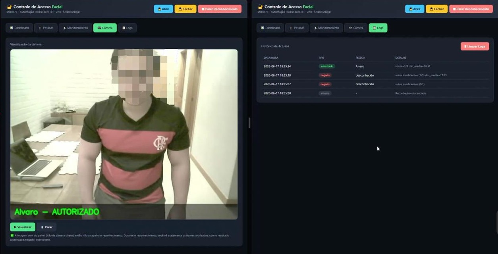
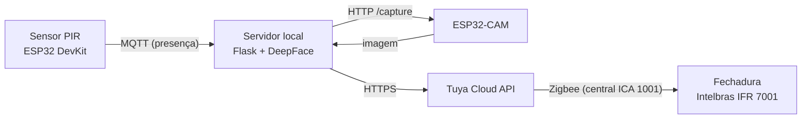
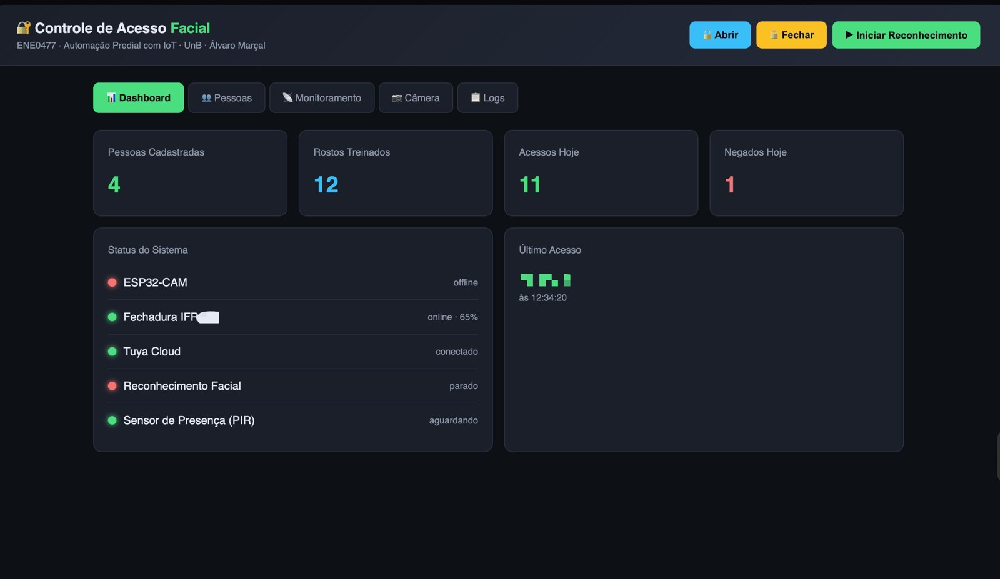
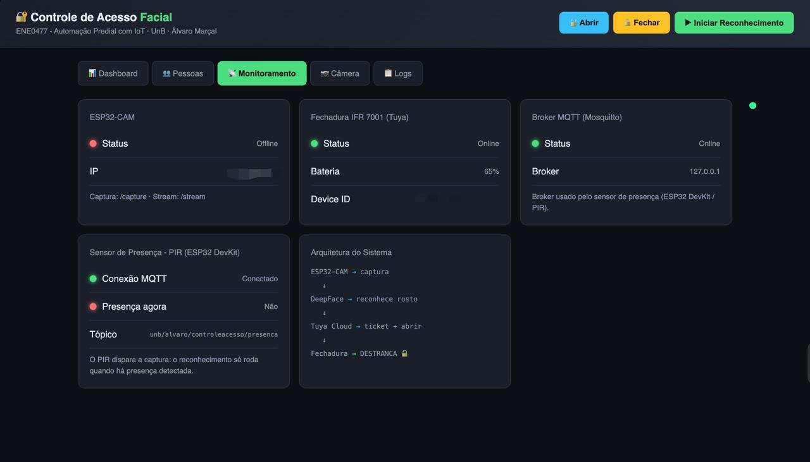
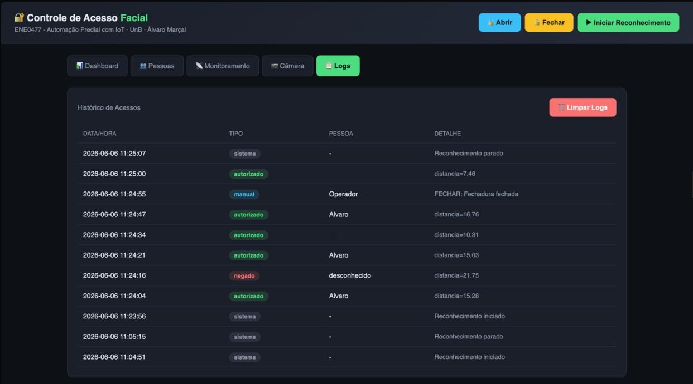
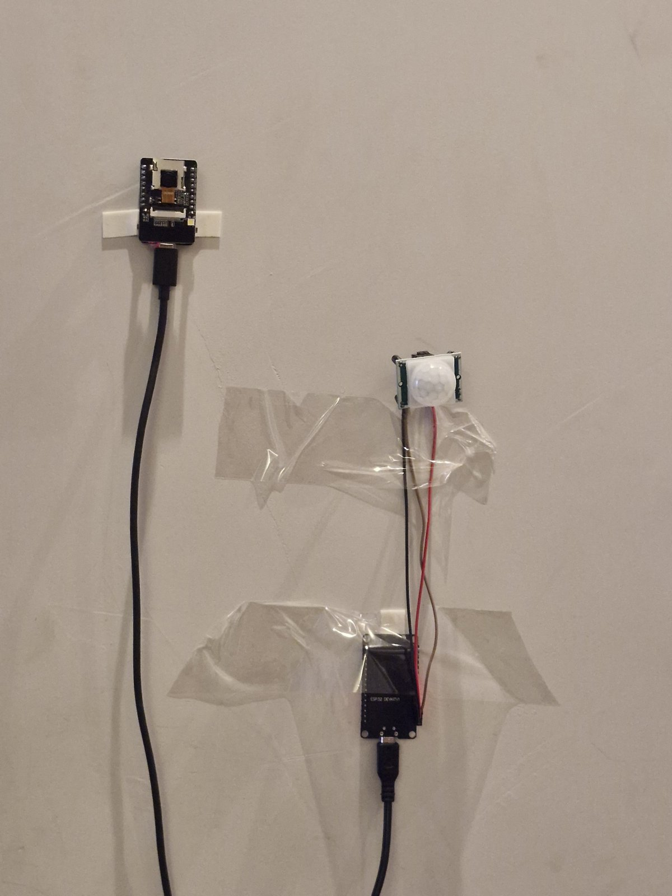

# Controle de Acesso por Reconhecimento Facial com IoT

Sistema de controle de acesso que combina reconhecimento facial, sensores IoT e uma fechadura inteligente comercial. Um sensor de presença dispara a captura, uma ESP32-CAM fotografa o rosto, um servidor local reconhece a pessoa com DeepFace (Facenet512) e, se ela estiver autorizada, a fechadura Intelbras IFR 7001 é aberta pela API da Tuya Cloud.

Projeto da disciplina **ENE0477, Automação Predial com IoT**, na Universidade de Brasília (UnB). O artigo completo está em [`docs/artigo.pdf`](docs/artigo.pdf).



## Como funciona



1. O sensor PIR, ligado a uma ESP32 DevKit, detecta movimento e publica uma mensagem MQTT.
2. O servidor só inicia a captura quando há presença recente, evitando processar imagens o tempo todo.
3. A ESP32-CAM entrega a imagem pelo endpoint HTTP `/capture`.
4. O servidor descarta imagens ruins, extrai o embedding facial e compara com as pessoas cadastradas.
5. Se a pessoa for reconhecida, o servidor envia o comando de abertura para a Tuya Cloud, que o repassa à fechadura pela central Zigbee.
6. Cada decisão fica registrada no histórico de acessos.

O reconhecimento roda no servidor, não no microcontrolador. As placas cuidam da detecção de presença e da captura (borda), e o modelo de deep learning roda num computador da rede local. Essa arquitetura híbrida permite usar um modelo mais robusto do que caberia na memória da ESP32.

### Decisão de acesso

Para reduzir decisões erradas causadas por uma única imagem ruim, o servidor combina quatro etapas:

- **Filtro de qualidade:** descarta capturas borradas (variância do Laplaciano) ou com brilho fora da faixa aceitável.
- **Detecção de rosto:** um Haar Cascade do OpenCV descarta frames sem rosto antes de chamar o DeepFace.
- **Distância média por pessoa:** o embedding capturado é comparado com a média das distâncias para todas as fotos de cada pessoa, não com uma foto isolada.
- **Votação:** são feitas 3 capturas, e o acesso só é liberado se pelo menos 2 concordarem na mesma pessoa com distância abaixo do limiar.

Esses parâmetros ficam no início de `servidor/app.py` (`TOLERANCE`, `N_CAPTURAS`, `VOTOS_MINIMOS`, `NITIDEZ_MINIMA`, `BRILHO_MINIMO`, `BRILHO_MAXIMO`).

## Painel web

O painel em Flask permite cadastrar pessoas e enviar fotos, treinar o modelo, iniciar e parar o reconhecimento, abrir e fechar a fechadura manualmente, acompanhar o estado dos dispositivos e consultar o histórico de acessos. Ele pode ser aberto de outros dispositivos da mesma rede, como um tablet ao lado da porta.

| Dashboard | Monitoramento |
|---|---|
|  |  |

| Histórico de acessos | Hardware instalado |
|---|---|
|  |  |

## Hardware

- ESP32-CAM (AI-Thinker): captura das imagens
- ESP32 DevKit + sensor PIR HC-SR501: detecção de presença
- Fechadura inteligente Intelbras IFR 7001 (Zigbee)
- Central Intelbras ICA 1001: ponte entre Zigbee e a nuvem Tuya
- Um computador na rede local para o servidor de inferência, o painel e o broker MQTT

## Estrutura do repositório

```
servidor/
  app.py                  # painel Flask, reconhecimento, MQTT e integração Tuya
  templates/index.html    # interface do painel
firmware/
  esp32-cam/              # servidor HTTP da câmera (/capture e /stream)
  esp32-devkit-pir/       # leitura do PIR e publicação MQTT
docs/
  artigo.pdf              # artigo do projeto
  img/                    # capturas de tela e foto do hardware
requirements.txt
.env.example
```

## Como executar

### 1. Broker MQTT

Instale o [Mosquitto](https://mosquitto.org/) no computador que vai rodar o painel. As placas se conectam a ele pela rede local, então o broker precisa aceitar conexões externas. No Mosquitto 2.x isso exige um `listener` no `mosquitto.conf`, por exemplo:

```
listener 1883
allow_anonymous true
```

Essa configuração sem autenticação serve para um laboratório. Veja a seção de segurança.

### 2. Firmware

O firmware foi escrito em C++ com o framework Arduino, usando PlatformIO.

1. Em cada pasta de `firmware/`, copie `secrets.example.h` para `secrets.h` e preencha a rede Wi-Fi, os IPs fixos e, no caso do PIR, o IP do broker.
2. Crie um projeto PlatformIO para cada placa (por exemplo, `esp32cam` para a câmera e `esp32dev` para a DevKit) e coloque o `.cpp` e o `secrets.h` em `src/`.
3. A DevKit usa a biblioteca `PubSubClient` para MQTT.
4. Ligação do PIR: VCC no 5V (VIN), OUT no GPIO13 e GND no GND.

### 3. Servidor

```bash
python -m venv .venv
source .venv/bin/activate        # no Windows: .venv\Scripts\activate
pip install -r requirements.txt

cp .env.example .env             # preencha as credenciais da Tuya, o IP da câmera e a senha do painel
python servidor/app.py
```

O painel abre em `http://localhost:5000`.

### 4. Cadastro e treino

1. Na aba **Pessoas**, cadastre um nome e envie fotos. Elas ficam em `fotos_autorizadas/<nome>/`.
2. Clique em **Treinar Modelo** para gerar os embeddings (`encodings.pkl`).
3. Clique em **Iniciar Reconhecimento**.

Use várias fotos por pessoa, de preferência tiradas pela própria ESP32-CAM, com a iluminação e a distância reais de uso. Nos testes, uma pessoa cadastrada com poucas fotos não era reconhecida de forma consistente, e o problema foi resolvido ao ampliar o cadastro para cinco fotos nessas condições.

## Resultados

O protótipo funcionou de ponta a ponta: capturou as imagens da ESP32-CAM, reconheceu as pessoas cadastradas e abriu a fechadura comercial automaticamente. Nos testes, as distâncias médias das pessoas reconhecidas ficaram tipicamente entre 15 e 18, para um limiar de 20.

Ainda não foram medidas métricas quantitativas como acurácia, taxa de falsos positivos e latência. Essa avaliação está entre os trabalhos futuros.

**Limitações observadas:** a ESP32-CAM é sensível a variações na alimentação elétrica, o que pode causar reinicializações; a iluminação afeta a qualidade do reconhecimento; e a abertura depende de conexão com a internet, porque o comando passa pela nuvem da Tuya.

## Segurança e privacidade

Este é um protótipo acadêmico, não um produto pronto para proteger um ambiente real.

- **Login do painel:** com `PAINEL_SENHA` definida no `.env`, todas as rotas exigem usuário e senha (HTTP Basic). Sem senha, qualquer pessoa na rede consegue abrir a fechadura pelo painel, e o servidor avisa isso ao iniciar. Como o painel usa HTTP sem TLS, a senha trafega sem criptografia: use apenas em rede local confiável.
- **Validação de entradas:** nomes de pessoas e de arquivos são validados para impedir acesso ou remoção de arquivos fora da pasta de fotos.
- **MQTT sem autenticação:** com a configuração acima, qualquer dispositivo na rede pode publicar no tópico de presença. Isso só dispara uma captura, não abre a fechadura, mas em uso real o broker deve exigir usuário e senha.
- **Sem anti-spoofing:** o sistema não detecta se o rosto é real ou uma foto.
- **Dados biométricos:** fotos e embeddings faciais são dados pessoais sensíveis pela LGPD. Eles ficam apenas na máquina local, estão no `.gitignore` e nunca devem ser publicados. Cadastre pessoas somente com o consentimento delas.
- **Arquivo de embeddings:** `encodings.pkl` é carregado com `pickle`. Use apenas arquivos gerados pelo próprio sistema.

## Trabalhos futuros

- Anti-spoofing contra fotos e vídeos
- Registro da imagem de cada tentativa de acesso, para auditoria
- Redução da latência entre a detecção de presença e a captura
- Avaliação de acurácia, falsos positivos e latência em diferentes condições
- Autenticação no broker MQTT e HTTPS no painel

## Tecnologias

Python, Flask, DeepFace (Facenet512), OpenCV, MQTT (Mosquitto, paho-mqtt, PubSubClient), C++ (Arduino, PlatformIO), ESP32-CAM, ESP32, Tuya Cloud API, Zigbee.

## Autor

Álvaro Marçal de Araujo, Engenharia de Redes de Comunicação, Universidade de Brasília.

## Licença

[MIT](LICENSE)
